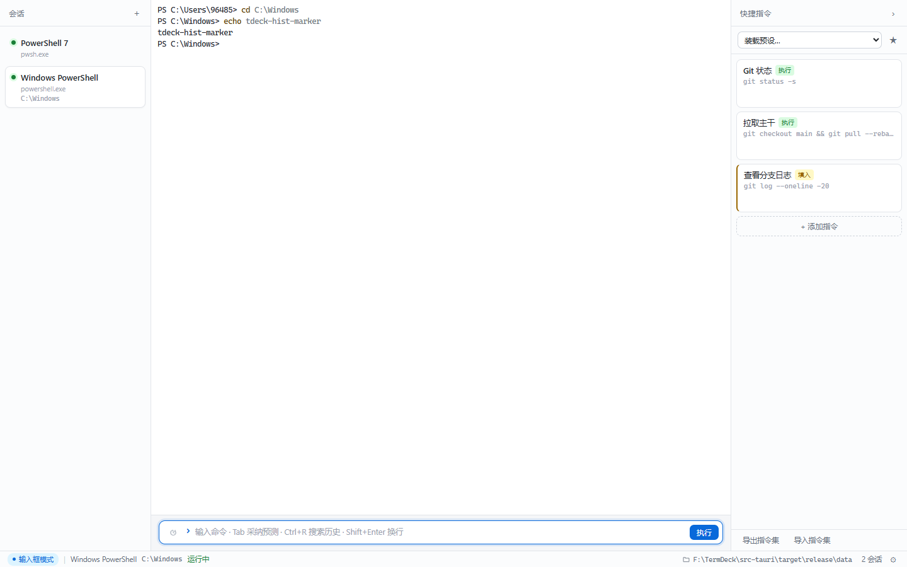
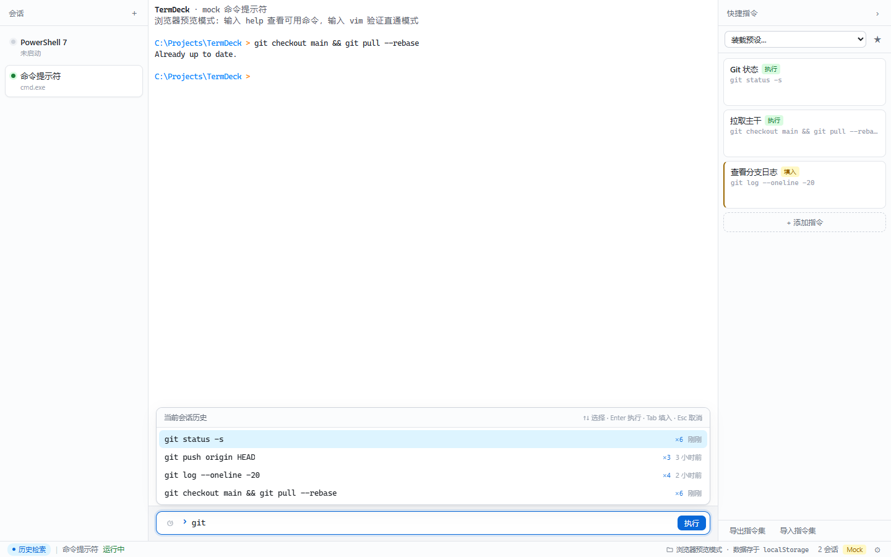

# TermDeck

> Windows 上的增强型工作流终端 —— 跨 Shell 统一的命令输入、会话级物理隔离、冷启动无缝还原。



底层是 Rust + ConPTY，界面用 WebView2 渲染 `xterm`，安装包不到 10 MB，常驻不占 CPU。

---

## 它解决什么

Windows 上做多项目开发，终端有三个绕不过去的麻烦：

**长命令记不住也懒得敲。** 编译、烧录、部署这类命令又长又固定，每次都要翻文档复制。Shell 自带的补全只认它自己见过的东西。

**每个 Shell 一套肌肉记忆。** PowerShell 的 `Tab` 补全、cmd 的历史、WSL 的 readline，快捷键和行为各不相同，切换一次就要重新适应一次。

**上下文会串味。** 同时开着三四个项目，历史记录混在一起，配置互相覆盖，关掉再打开一切归零。

TermDeck 的做法是：**把输入层从 Shell 里抽出来自己实现**，这样补全、历史、快捷键在 PowerShell / CMD / WSL / Git Bash 上完全一致；同时把每个会话做成真正独立的单元，历史、配置、进程互不干扰。

---

## 核心特性

### 解耦的命令输入条

底部是独立的输入框，不再依赖 Shell 内部的行编辑器。多行编辑、`Shift+Enter` 换行、鼠标选光标、系统剪贴板全部可用。

### Ghost Text 预测补全

输入时按前缀检索**当前会话自己的**历史，把未输入的部分用灰色显示在光标后面。`Tab` / `→` / `Ctrl+→`（按词）都能采纳，按键可在设置里多选。查询带 40 ms 防抖和请求序号丢弃，快速输入不会闪出过期的预测。

### 全屏程序自动退让

启动 `vim`、`htop`、`less`、`ssh` 这类全屏程序时，输入框自动折叠、焦点交给终端，所有按键原样透传；退出后自动收回。判定依据是 xterm 的备用缓冲区事件，不靠猜进程名，`ssh` 套 `vim` 也不会判断错。

### 历史检索浮层

`Ctrl+R` 在输入框上方弹出检索面板，模糊匹配当前会话历史。`↑↓` 选择、`Enter` 直接执行、`Tab` 填回输入框、`Esc` 还原原文。

历史存在 SQLite 里，关掉软件再打开依然在。要清空时点输入框右侧的垃圾桶按钮——会先确认，且**只清当前会话**，其他会话不受影响。



### 快捷指令面板

右侧是与当前会话绑定的按钮列表，两种模式：**执行**（点了就跑）和**填入**（只放进输入框，等你补参数）。支持预设模板、拖拽排序、导入导出指令集。

关键点是**隔离开**：从模板载入时做深拷贝，之后你在 A 会话改按钮，B 会话和模板本身都不受影响。

### 文件目录面板

右侧栏可以上下分屏，下半部分是可开关的文件浏览器，跟着终端走。

- **跟随模式（默认）**：终端 `cd` 到哪，面板就显示哪。靠的是 OSC 7 和 `cd` 拦截拿到的 CWD。
- **固定模式**：锁定当前路径，终端里怎么切目录都不影响它。
- 面包屑可点击回退，双击/单击文件夹进入子目录，双击文件用系统默认程序打开。
- 显隐、模式、固定路径都按**会话**保存，重启后原样恢复。

> 后端不装任何文件系统监听：只在「点刷新」「进入子目录」「收到 CWD 变更」这三个时机读一次目录，
> 面板折叠或会话在后台时不产生任何读取。空闲时零开销。

### 会话级物理隔离

每个会话有独立的 PTY 进程、独立的历史库（同一 SQLite 文件内以稳定 `session_id` 隔离）、独立的快捷指令快照。

### 关闭即还原

窗口尺寸、会话树、自定义标题、工作目录、快捷指令、历史索引全部落盘。强杀进程也不会损坏文件——写入走「临时文件 → fsync → 原子改名」，上一个版本保留为 `.bak` 可回退。

### 便携数据目录

所有运行数据在可执行文件同级的 `data/` 目录，换台机器整个文件夹拷走即可，包括历史和配置。状态栏右下角显示路径，点一下直接打开。

---

## 快速开始

### 需要什么

- Windows 10 1809+ / Windows 11（x64）
- Node.js 20+
- Rust 1.77+ 与 VS 2022 生成工具（C++ 工作负载）

> 完整的环境搭建步骤（含国内镜像、常见报错）见 [构建指南](docs/BUILDING.md)。

### 构建与运行

```bat
npm install
scripts\build.bat        :: 生产构建，产出 src-tauri\target\release\termdeck.exe
scripts\run.bat          :: 启动
```

开发模式（前端热更新）：

```bat
scripts\dev.bat
```

只跑前端、不装 Rust 也能看界面 —— 浏览器下会走内置的模拟 Shell：

```bash
npm run dev     # http://localhost:1420
```

> ⚠️ 不要直接用 `cargo build`。Tauri 需要 `custom-protocol` feature，否则二进制仍指向
> 开发服务器地址，窗口会全白。`scripts\build.bat` 内部走 `npx tauri build`。

### 打发布包

```bat
scripts\release.bat              :: 便携版 zip，约 8 MB，离线可用
scripts\release.bat --installer  :: 额外生成 NSIS 安装包（需要 github.com 可达）
```

产物在 `release/` 目录。便携版解压即用、数据跟着文件夹走，不写注册表。
推 `v*` tag 会触发 GitHub Actions 自动打包并创建草稿 Release。

网络受限、版本号怎么改、安装器打不出来怎么办，都写在 [发布指南](docs/RELEASE.md) 里。

---

## 快捷键

| 快捷键 | 作用 |
| --- | --- |
| `Enter` | 执行命令 |
| `Shift + Enter` | 输入框内换行 |
| `Tab` / `→` | 采纳 Ghost Text 预测 |
| `Ctrl + →` | 按词采纳预测 |
| `Ctrl + R` | 打开历史检索浮层 |
| `↑` / `↓` | 空输入框时翻阅本会话历史（↑ 更旧、↓ 更新，翻过最新一条回到你原本输入的内容） |
| `Esc` | 放弃预测 / 关闭浮层并还原原文 |
| `Ctrl + Shift + P` | 切换「输入框模式 / 原生直通模式」 |
| `Ctrl + Shift + T` | 新建会话 |
| `Ctrl + Shift + W` | 关闭当前会话 |
| `Ctrl + Tab` | 切换到下一个会话 |
| `Ctrl + Shift + E` | 折叠/展开快捷指令面板 |

直通模式下所有快捷键让位给 PTY，只有 `Ctrl + Shift + P` 例外。

---

## 架构

```
┌─────────────────────── Frontend (WebView2) ────────────────────────┐
│  左栏会话树  │  xterm + 命令输入条 + 历史浮层   │  右侧快捷指令面板  │
└───────────────────────────────┬────────────────────────────────────┘
                                │ Tauri IPC（事件流 + 命令）
┌───────────────────────────────▼────────────────────────────────────┐
│                          Backend (Rust)                            │
│   ConPTY 管理（portable-pty）  │  SQLite 历史库（rusqlite）          │
│   输出回放与背压               │  工作区原子落盘 + .bak 回退         │
└────────────────────────────────────────────────────────────────────┘
```

| 层 | 选型 | 职责 |
| --- | --- | --- |
| 宿主 | Tauri v2 | 窗口生命周期、文件 I/O、Windows API |
| PTY | portable-pty（ConPTY） | 每条会话一个真实子进程，管理 stdin/stdout 与尺寸 |
| 存储 | SQLite（rusqlite） | 会话隔离的历史、去重计数、FIFO 修剪、模糊检索 |
| 前端 | React 19 + TypeScript + Vite + Zustand | UI、状态、键盘事件仲裁 |
| 渲染 | @xterm/xterm（WebGL 可关） | ANSI 解析、GPU 字符网格、备用缓冲检测 |

几个关键设计：

- **会话身份拆成两层**：稳定的 `key` 负责历史、持久化和 React key；临时的 `ptyId` 只表示当前运行的进程。重启后 `key` 不变，历史自然还在。
- **启动前的输出不会丢**：后端为每条会话保留 256 KB 回放缓冲，前端先订阅再 `attach`，Shell 的欢迎语一条不落。
- **历史写入不阻塞输入**：SQLite 挂在独立队列上，写失败也不影响命令执行。

更多细节见 [需求规格说明书](docs/SRS.md) 与 [实施与验收计划](docs/PLAN.md)。

---

## 数据目录

```
data/
├── workspace_state.json   会话树 / 布局 / 快捷指令快照
├── workspace_state.bak    上一版快照（主文件损坏时回退）
├── termdeck.db            SQLite 历史库（WAL）
├── termdeck.log           后端运行日志
├── presets.json           预设库
├── settings.json          应用设置
└── exports/               导出的指令集 JSON
```

安装到只读目录（如 Program Files）时会自动回退到 `%APPDATA%\as.ixuhan.termdeck\`。

---

## 开发与测试

```bat
scripts\test.bat              :: Rust 单测（模糊匹配、LIKE 转义、敏感掩码）
npm run build                 :: 前端类型检查 + 构建
node scripts\shot.mjs         :: 浏览器 Mock 套件（15 项断言）
node scripts\regress.mjs      :: 验收反馈回归（12 项断言）
node scripts\app-e2e.mjs      :: 真实应用端到端（需 Edge + WebView2 调试端口）
node scripts\desktop-verify.mjs :: 关闭、历史持久化、目录持久化
```

测试脚本用 Playwright 驱动系统自带的 Edge，不需要额外下载浏览器。桌面端的脚本通过
`WEBVIEW2_ADDITIONAL_BROWSER_ARGUMENTS=--remote-debugging-port=9222` 接管真实窗口。

---

## 已知限制

- **目录追踪**靠 OSC 7 和 `cd` 命令拦截。如果你用 `z`、`pushd -` 或在脚本里切目录，可能跟不到；此时文件面板会停在原路径，可手动点刷新或切成固定模式。
- **内存地板**约 590 MB（其中 WebView2 约 440 MB）。这是 WebView2 运行时本身的开销，不是应用逻辑的问题。想更省就少开几个会话——未激活的会话不会启动 Shell 进程。
- **设置面板**尚未支持快捷键改键与主题切换。
- 仅支持 Windows x64。

---

## 文档

| 文档 | 内容 |
| --- | --- |
| [需求规格说明书](docs/SRS.md) | 功能需求编号、验收标准、数据模型、状态机 |
| [实施与验收计划](docs/PLAN.md) | 阶段拆分、门禁、用例清单、准出标准 |
| [构建指南](docs/BUILDING.md) | 从零配环境、国内镜像、8 条常见报错 |
| [发布指南](docs/RELEASE.md) | 三种出包方式、版本号约定、网络受限的解法 |
| [变更记录](docs/CHANGELOG.md) | 版本改动与实测数据 |

---

## License

MIT
